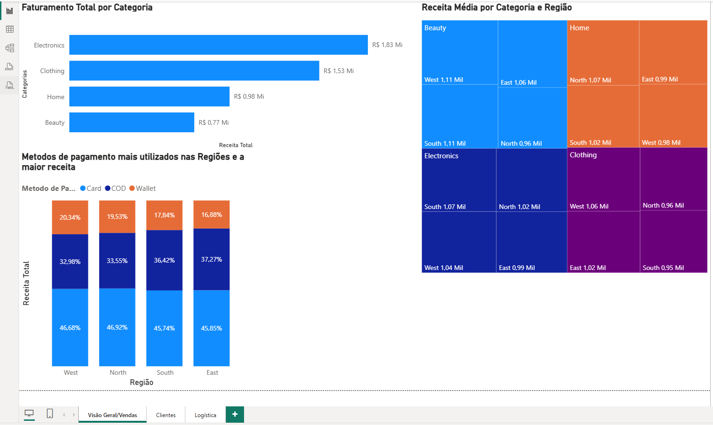
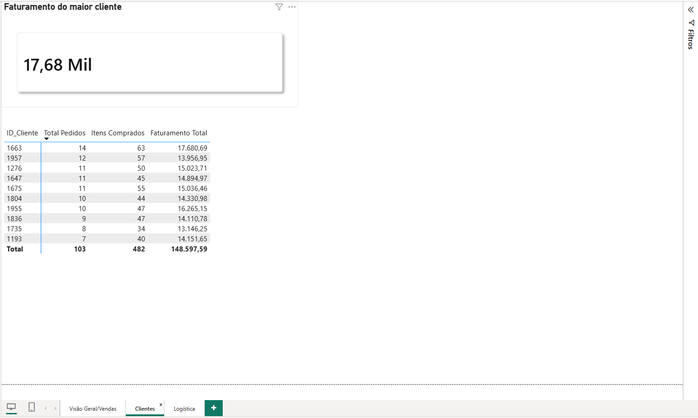
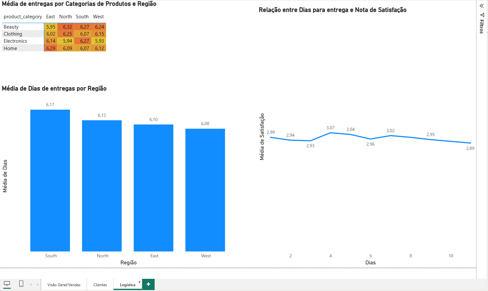

# Análise de Vendas, Logística e Satisfação em E-commerce (SQL + Power BI) 🛒

> Quais categorias e regiões geram mais receita, como está a logística e o prazo de entrega afeta a satisfação do cliente?

Projeto de análise de negócios com **SQL** sobre uma base de vendas de e-commerce. As consultas calculam as métricas, e um dashboard em **Power BI** apresenta os resultados para apoiar decisões.

## Dashboard 

**Visão Geral / Vendas**


**Clientes**


**Logística**


🔗 [Abrir o relatório completo no Power BI](https://app.powerbi.com/links/EKkMwvyfb7?ctid=cf72e2bd-7a2b-4783-bdeb-39d57b07f76f&pbi_source=linkShare)

## Perguntas de negócio

1. Quais categorias e regiões geram mais receita?
2. Como o faturamento se distribui entre os clientes?
3. Quais meios de pagamento são mais usados em cada região?
4. Qual o prazo médio de entrega por região e categoria?
5. O prazo de entrega influencia a nota de satisfação?

## Principais insights

- **Receita concentrada em duas categorias:** Eletrônicos (R$ 1,83 Mi) e Roupas (R$ 1,53 Mi) somam cerca de dois terços do faturamento (≈ R$ 5,1 Mi no total), seguidas por Home (R$ 0,98 Mi) e Beauty (R$ 0,77 Mi).
- **Ticket médio por região:** Beauty teve a maior receita média em West e South (R$ 1,11 mil), enquanto Clothing teve a menor em South (R$ 0,95 mil).
- **Pagamento:** o cartão é o principal meio em todas as regiões (≈ 46% da receita). O pagamento na entrega (COD) representa mais de um terço, com maior peso em East (37,3%).
- **Clientes:** o maior cliente (ID 1663) gerou **R$ 17,68 mil em 14 pedidos**. Os 10 clientes que mais gastaram somam R$ 148,6 mil, apenas **2,9% do faturamento**: a receita é pulverizada, sem dependência de poucos clientes. A base tem 989 clientes, com média de 5 pedidos cada.
- **Ticket médio:** R$ 1.021,96 por pedido.
- **Logística:** o prazo médio fica em torno de **6 dias em todas as regiões** (de 6,08 a 6,17). O maior valor por combinação é Beauty em North (6,32 dias), uma diferença pequena frente à média, que sugere acompanhar a rota e não indica um gargalo grave.
- **Satisfação:** a nota média ficou estável, entre **2,89 e 3,07** (escala de 1 a 5) para entregas de 1 a 11 dias. As maiores notas foram em entregas de 4 dias (3,07) e 5 dias (3,04), mas a correlação entre prazo e nota é praticamente nula (≈ -0,02). Nesta base, o prazo não explica a satisfação.

## Exemplo de consulta

```sql
-- Participação de cada meio de pagamento na receita de cada região
SELECT region,
       payment_method,
       ROUND(SUM(revenue), 2) AS receita_total,
       ROUND(100.0 * SUM(revenue) / SUM(SUM(revenue)) OVER (PARTITION BY region), 2) AS pct_receita_regiao
FROM ecommerce_sales
GROUP BY region, payment_method
ORDER BY region, pct_receita_regiao DESC;
```

## Dados

| Item | Detalhe |
|---|---|
| Origem | Base simulada de uma operação de e-commerce (dados sintéticos) |
| Banco utilizado | SQLite |
| Tabela | `ecommerce_sales`, com uma linha por pedido |
| Volume | 5.000 pedidos · 989 clientes · 4 categorias · 4 regiões · 3 meios de pagamento |
| Arquivo | `data/ecommerce_sales.csv` |

**Colunas:** `order_id`, `order_date`, `customer_id`, `product_category`, `region`, `quantity`, `unit_price`, `discount`, `payment_method`, `delivery_days`, `customer_rating`, `revenue` (receita = quantidade × preço unitário × (1 − desconto)).

## Como reproduzir

1. Clone o repositório:
   ```bash
   git clone https://github.com/Vitor-neia/sql-ecommerce-sales.git
   cd sql-ecommerce-sales
   ```
2. Crie o banco e carregue os dados de `data/` .
3. Execute os arquivos da pasta `sql/` .
4. Os scripts em `scripts/` ligam com o banco de dados.
5. Abra o relatório no Power BI pelo link acima.

## Estrutura do repositório

```
├── data/        # base de dados
├── sql/         # consultas de negócio
├── scripts/     # scripts de automação em Python
├── img/         # prints do dashboard
├── LICENSE
└── README.md
```

## Tecnologias

- **SQL** (core): consultas, junções e agregações
- **Power BI**: dashboard de 3 páginas (Visão Geral/Vendas, Clientes e Logística)
- **Python**: scripts de automação

## Limitações

- Os dados são **simulados**, então os resultados não representam uma operação real.
- As datas dos pedidos são sequenciais (um pedido por dia, de 01/01/2022 a 09/09/2035, inclusive datas futuras), portanto **não foram usadas** para análise de sazonalidade ou evolução no tempo.
- A base é uma única tabela (flat): não há tabelas separadas de clientes, produtos e pedidos.
- Não foram feitos testes estatísticos: a relação entre prazo e satisfação é descritiva.
- Diferenças pequenas entre regiões e categorias podem ser ruído, e não tendência.


**Autor:** Vitor Augusto Neias · [LinkedIn](https://www.linkedin.com/in/vitor-augusto-neias-278a91210/) · [Portfólio](https://vitorneiadata.com.br)
